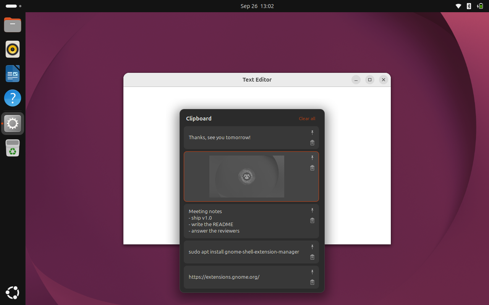
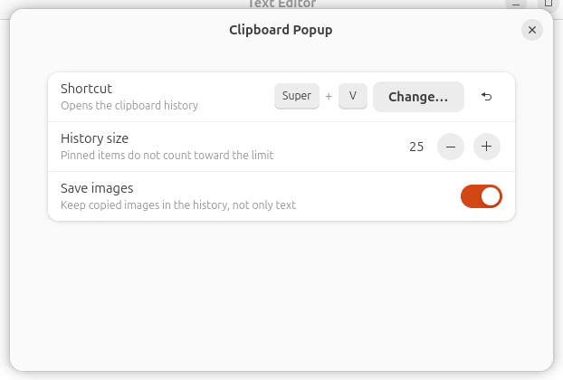

# Clipboard Popup

Windows-style clipboard history for GNOME Shell. Press **Super+V**, pick an item, and it is pasted into the window you were using.



## Features

- **Text and images**, newest first. Copying something that is already in the history moves it to the top instead of adding a duplicate.
- **Pinned items** never expire. After a reboot only pinned items remain, like on Windows.
- **Survives the screen lock.** GNOME disables extensions while the screen is locked; the history is kept in `$XDG_RUNTIME_DIR` so it is still there when you unlock.
- **Pastes for you** into the focused window, using Ctrl+Shift+V in terminals (GNOME Terminal, Ptyxis, Console, Kitty, Alacritty, foot, Ghostty, Tilix, Konsole, WezTerm and others).
- **Keyboard friendly**: arrows to move, Enter to paste, Delete to remove, Esc to close.
- **Skips passwords** copied from password managers that mark them as secret (KeePassXC, Bitwarden and others using `x-kde-passwordManagerHint`).
- **Takes care of the Super+V conflict**: GNOME binds Super+V to the notification list. While the extension is enabled it takes that shortcut over, and gives it back when disabled. The notification list stays on Super+M.

## Preferences



- Shortcut (default Super+V). Combinations already used by GNOME cannot be picked.
- History size, 5 to 100 items (default 25). Pinned items do not count.
- Whether to keep images.

## Installation

### From extensions.gnome.org

Coming soon.

### From a release zip

```bash
gnome-extensions install --force clipboard-popup@claudiosaitta.shell-extension.zip
```

Log out and back in (on Wayland GNOME Shell only picks up new extensions at login), then:

```bash
gnome-extensions enable clipboard-popup@claudiosaitta
```

### From source

```bash
git clone https://github.com/nessunohastonick/clipboard-popup.git
cd clipboard-popup
./build.sh
gnome-extensions install --force dist/clipboard-popup@claudiosaitta.shell-extension.zip
```

`build.sh` compiles the translations with Python, so gettext's `msgfmt` is not needed.

### Tests

```sh
tests/run.sh    # functional tests in an isolated headless GNOME Shell (your session is not touched)
tests/lint.sh   # Shexli, the analyzer extensions.gnome.org runs on uploads
```

## Where data is stored

| What | Where | Lifetime |
|---|---|---|
| Full history | `$XDG_RUNTIME_DIR/clipboard-popup/` | until logout or reboot |
| Pinned items | `~/.local/share/clipboard-popup/` | until you unpin or delete them |

Nothing leaves your computer.

## Known limitations

- Only plain text is restored: formatting (bold, links) copied from rich-text apps is not kept.
- GNOME Shell 50 only for now.

## Translations

Translations live in `po/`. To add a language, copy `po/clipboard-popup@claudiosaitta.pot` to `po/<language>.po`, translate it and run `./build.sh`. Italian is included.

## License

[GPL-2.0-or-later](LICENSE)
